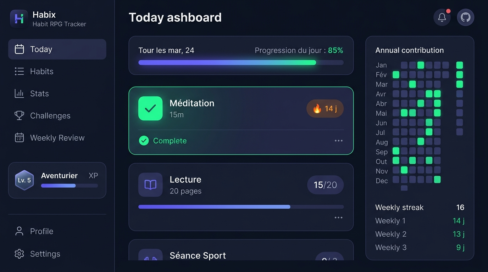

# ⚡ Habix — Suivi d'Habitudes Moderne & RPG Gamifié

> Application web progressive (PWA) de suivi d'habitudes, 100% locale et privée, inspirée des meilleures pratiques de Habitica, Streaks et Loop Habit Tracker.



[](https://www.typescriptlang.org/)
[](https://react.dev/)
[](https://vitejs.dev/)
[](https://tailwindcss.com/)
[](https://vitest.dev/)
[](https://dexie.org/)
[](https://developer.mozilla.org/fr/docs/Web/Progressive_web_apps)

---

## 🌟 Points Forts & Philosophie

- 🔒 **100% Local & Respectueux de la vie privée** : Aucune inscription requise, aucune télémétrie, aucune donnée sur un serveur externe. Tout est stocké dans votre navigateur via **IndexedDB** ([Dexie.js](https://dexie.org/)).
- 📱 **PWA Installable & Offline-First** : Utilisable sur mobile (iOS / Android) et desktop sans connexion Internet grâce au Service Worker dédié.
- 🎨 **Design Élégant & Immersion RPG** : Thème sombre/clair automatique, design glassmorphique soigné, animations fluides (Framer Motion) et confettis de célébration.
- 🔥 **Calcul de Streaks Mathématiquement Rigoureux** : Logique de streak pure et déterministe (sans dépendance aux fuseaux horaires implicites), gestion des **jours de gel** et des fréquences flexibles.
- 📊 **Visualisations de Données Riches** : Heatmap annuelle façon GitHub (365 jours), courbes d'évolution du taux de succès, radar de complétion hebdomadaire et corrélation humeur / discipline.

---

## 🚀 Fonctionnalités Clés

### 1. Suivi d'Habitudes Polyvalent
- **Fréquences adaptables** :
  - **Quotidienne** (tous les jours).
  - **Jours fixes de la semaine** (ex. : Lundi, Mercredi, Vendredi).
  - **Flexible** (ex. : 3 fois par semaine, quel que soit le jour).
  - **Intervalle** (ex. : tous les 3 jours).
- **Types d'objectifs** :
  - **Binaire (Oui/Non)** : à cocher simplement avec animation et micro-haptique.
  - **Chiffré / Numérique** : avec jauge de progression, incrément rapide et unité personnalisée (ex. : *20 pages*, *2500 ml d'eau*, *30 minutes*).
- **Organisation & Filtres** :
  - Catégorisation par couleur et emoji (Santé, Productivité, Bien-être, etc.).
  - Tri par streak, nom, date ou ordre manuel.
  - Système d'archivage et de restauration sans perte d'historique.

### 2. Gamification & Progression RPG
- **Expérience & Niveaux** :
  - Gagnez des **XP** à chaque complétion (+10 XP pour une habitude standard, +50 XP pour une journée parfaite).
  - Formule de progression RPG : franchissez les paliers du **Niveau 1 au Niveau 100**.
  - Débloquez des **Titres honorifiques** (Aventurier, Apprenti Régulier, Maître de la Volonté, etc.).
- **Jours de Gel (*Freeze Days*)** :
  - Obtenez des jetons de gel lors de la montée de niveau ou de séries parfaites.
  - Utilisez un jour de gel en cas d'imprévu, de maladie ou de voyage pour sauver votre streak sans tricher.
- **Collection de Badges & Succès** :
  - Badges de palier (7 jours, 30 jours, 100 jours, 365 jours de streak).
  - Badges spéciaux (Première habitude, Semaine parfaite, Noctambule, Lève-tôt...).
  - Popups de célébration animés avec détails et date de déverrouillage.

### 3. Statistiques Avancées (Recharts)
- 🟩 **Heatmap Annuelle (365 jours)** : Vue globale ou filtrée par habitude individuelle, affichant l'intensité des complétions sur l'année. Entièrement accessible au clavier avec navigation WAI-ARIA grid.
- 📈 **Courbe de Tendance** : Évolution du taux de réussite lissé sur 7, 30, 90 ou 365 jours.
- 📊 **Répartition par Jour de la Semaine** : Découvrez vos jours les plus productifs du lundi au dimanche.
- ⚖️ **Comparateur d'Habitudes** : Visualisez l'efficacité relative de chaque routine.

### 4. Journal d'Humeur & Corrélations
- Enregistrement quotidien de votre niveau d'énergie et humeur (1 à 5).
- Association de tags émotionnels (*motivé*, *calme*, *stressé*, *fatigué*, etc.) et notes textuelles.
- **Analyse croisée** : Graphique de corrélation mettant en évidence l'impact de vos habitudes sur votre bien-être mental.

### 5. Défis Ciblés 21 & 30 Jours
- Lancez des programmes intensifs pour ancrer durablement une habitude clé.
- Suivi visuel de l'avancement jour par jour avec taux de complétion.

### 6. Revue Hebdomadaire Automatique
- Génération automatique d'un bilan chaque dimanche et lundi.
- Détection de votre « Top Habitude », de l'habitude nécessitant un coup de pouce, et de la note moyenne de la semaine.

### 7. Sauvegarde & Portabilité des Données
- **Export JSON complet** : Exportez en un clic l'intégralité de votre profil, habitudes, complétions, humeurs et badges.
- **Import JSON sécurisé** : Validateur de schéma strict avec désinfection des entrées et rejet des structures corrompues.

### 8. Raccourcis Clavier & Ergonomie
| Touche | Action |
|:---:|---|
| <kbd>1</kbd> | Page **Aujourd'hui** |
| <kbd>2</kbd> | Page **Habitudes** |
| <kbd>3</kbd> | Page **Statistiques** |
| <kbd>4</kbd> | Page **Défis** |
| <kbd>5</kbd> | Page **Revue Hebdomadaire** |
| <kbd>6</kbd> | Page **Profil & Badges** |
| <kbd>7</kbd> | Page **Paramètres** |
| <kbd>n</kbd> | **Nouvelle habitude** (ouvre le modal de création) |
| <kbd>m</kbd> | **Journal de l'humeur** |
| <kbd>d</kbd> | Basculer entre le **Thème Sombre** et le **Thème Clair** |
| <kbd>?</kbd> | Afficher l'aide des **Raccourcis Clavier** |

---

## 🛠️ Stack Technique

| Domaine | Technologie |
|---|---|
| **Langage** | [TypeScript 5.6](https://www.typescriptlang.org/) |
| **Framework UI** | [React 18.3](https://react.dev/) + [Vite 5.4](https://vitejs.dev/) |
| **Styles & Design** | [Tailwind CSS 3.4](https://tailwindcss.com/) + Variables CSS HSL |
| **Animations** | [Framer Motion 14](https://www.framer.com/motion/) + [Canvas Confetti](https://www.npmjs.com/package/canvas-confetti) |
| **Base de Données Locale** | [Dexie.js 4.0](https://dexie.org/) (Wrapper IndexedDB réactif) |
| **State Management** | [Zustand 4.5](https://github.com/pmndrs/zustand) |
| **Graphiques** | [Recharts 2.13](https://recharts.org/) |
| **Dates & Fuseaux** | [date-fns 3.6](https://date-fns.org/) + Module pur `src/lib/date-utils.ts` |
| **PWA & Offline** | [vite-plugin-pwa 0.21](https://vite-pwa-org.netlify.app/) |
| **Tests Unitaires** | [Vitest 2.1](https://vitest.dev/) (63 tests unitaires) |
| **Qualité & Formatage** | [ESLint 9](https://eslint.org/) (Flat config) + [Prettier](https://prettier.io/) |

---

## 📥 Installation & Démarrage

### Prérequis
- [Node.js](https://nodejs.org/) version **18.x** ou supérieure.
- Gestionnaire de paquets `npm` (ou `pnpm` / `yarn`).

### 1. Cloner le dépôt
```bash
git clone https://github.com/votre-compte/habix.git
cd habix
```

### 2. Installer les dépendances
```bash
npm install
```

### 3. Lancer le serveur de développement
```bash
npm run dev
```
L'application est accessible immédiatement sur [http://localhost:5173/](http://localhost:5173/).

---

## 📜 Scripts NPM Disponibles

| Commande | Description |
|---|---|
| `npm run dev` | Démarre le serveur Vite de développement local avec rechargement à chaud (HMR). |
| `npm run build` | Vérifie les types TypeScript (`tsc -b`) et compile le bundle optimisé pour la production dans `/dist`. |
| `npm run preview` | Prévisualise en local le bundle de production généré. |
| `npm run typecheck` | Exécute la vérification statique des types TypeScript sans émettre de fichiers. |
| `npm run lint` | Analyse le code source avec **ESLint** (TypeScript, React Hooks, bonnes pratiques). |
| `npm run lint:fix` | Corrige automatiquement les avertissements et erreurs de style détectés par ESLint. |
| `npm run format` | Met en forme l'ensemble du projet selon les règles **Prettier**. |
| `npm run format:check` | Vérifie si tous les fichiers respectent la mise en page Prettier. |
| `npm run test` | Exécute la suite complète des **63 tests unitaires** avec **Vitest**. |
| `npm run test:watch` | Exécute les tests en mode interactif réactif lors des modifications de fichiers. |
| `npm run test:coverage` | Génère un rapport de couverture de code (V8 provider). |
| `npm run icons` | Régénère les icônes PWA (192x192, 512x512, maskable) dans `public/icons/`. |
| `npm run electron:dev` | Lance l'application de bureau en mode développement avec Electron. |
| `npm run electron:build` | Génère les exécutables Windows (installateur NSIS `.exe` et version portable) dans le dossier `/release`. |

---

### 💻 Application de Bureau Windows (Electron)

Habix peut être empaqueté en application de bureau native Windows indépendante :
```bash
npm run electron:build
```
Les exécutables générés se trouvent dans le dossier `/release` :
- **`Habix Setup 1.0.0.exe`** : Installateur complet NSIS (sélection du dossier d'installation, raccourcis Bureau et Menu Démarrer, désinstallateur propre).
- **`release/win-unpacked/Habix.exe`** : Version décompressée pour exécution immédiate.

---

## 📁 Architecture du Code

```text
habix/
├── docs/                      # Spécifications et documentation d'architecture
│   ├── ARCHITECTURE.md        # Architecture logicielle, schéma Dexie et flux de données
│   ├── DESIGN.md              # Direction artistique, palettes, typographie et composants
│   ├── PLAN.md                # Plan d'implémentation ordonnancé
│   ├── SPEC.md                # Spécification fonctionnelle complète
│   ├── STREAK_RULES.md        # Spécification formelle du calcul des séries et cas limites
│   └── screenshots/           # Captures d'écran et visuels
├── public/                    # Assets publics (manifest PWA, icônes)
├── scripts/                   # Scripts utilitaires Node.js (génération d'icônes)
├── src/
│   ├── components/            # Composants React modulaires
│   │   ├── challenges/        # Modaux et suivi des défis 21/30 jours
│   │   ├── gamification/      # Modaux de passage de niveau et badges
│   │   ├── habits/            # Cartes d'habitudes, formulaire modal, saisie numérique
│   │   ├── layout/            # Layout adaptatif (sidebar desktop, bottom nav mobile)
│   │   ├── mood/              # Modal d'enregistrement d'humeur
│   │   ├── stats/             # Heatmap annuelle, graphiques Recharts, cartes KPI
│   │   └── ui/                # Boutons, cartes, modaux accessibles, états vides
│   ├── constants/             # Définitions des badges, niveaux et constantes
│   ├── db/                    # Schéma Dexie.js, migrations et repositories
│   ├── lib/                   # Fonctions pures (calcul de streaks, utilitaires de dates)
│   ├── models/                # Interfaces TypeScript des entités métiers
│   ├── pages/                 # Vues principales de l'application
│   ├── services/              # Logique métier (XP, badges, export/import, revues, notifications)
│   ├── stores/                # Stores réactifs Zustand
│   └── utils/                 # Helpers divers (confettis, formatage)
├── eslint.config.js           # Configuration ESLint 9 (Flat config)
├── .prettierrc                # Configuration Prettier
├── package.json               # Dépendances et scripts de build
├── tailwind.config.js         # Configuration Tailwind CSS
├── tsconfig.json              # Configuration TypeScript
└── vite.config.ts             # Configuration Vite et plugin PWA
```

---

## 🧪 Tests Unitaires & Fiabilité

Le projet inclut une suite de tests unitaires complète couvrant les algorithmes critiques :

```bash
$ npm test

 ✓ src/services/import-export.test.ts (4 tests)
 ✓ src/services/xp.test.ts (7 tests)
 ✓ src/services/badges.test.ts (4 tests)
 ✓ src/lib/streaks.test.ts (29 tests)
 ✓ src/lib/date-utils.test.ts (15 tests)
 ✓ src/db/repositories/repositories.test.ts (4 tests)

 Test Files  6 passed (6)
      Tests  63 passed (63)
```

- **Calcul des Streaks (`streaks.test.ts`)** : Testé sur tous les cas limites (habitudes quotidiennes, hebdo flexibles, intervalles, jours de gel rétroactifs, isolation inter-habitudes, séries interrompues).
- **Date Utils (`date-utils.test.ts`)** : Minuit, passages à l'heure d'été/d'hiver, comparaison de dates locales strictes sans décalage UTC.
- **Sécurité d'Import JSON (`import-export.test.ts`)** : Rejet des données corrompues, validation de types et prévention des injections.
- **Système RPG (`xp.test.ts` & `badges.test.ts`)** : Calcul exact des gains d'XP, franchissement de niveaux et déverrouillage de badges.

---

## 🔒 Confidentialité & Licence

- **Confidentialité** : Habix ne collecte, ne transmet et ne vend aucune donnée personnelle. Vos habitudes, humeurs et historiques restent exclusivement sur votre appareil.
- **Licence** : Projet distribué sous licence MIT. Vous êtes libre de l'utiliser, le modifier et l'adapter à vos besoins.
