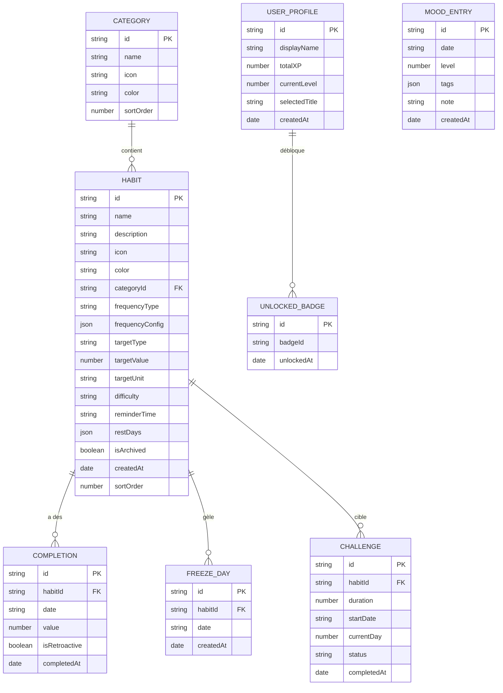
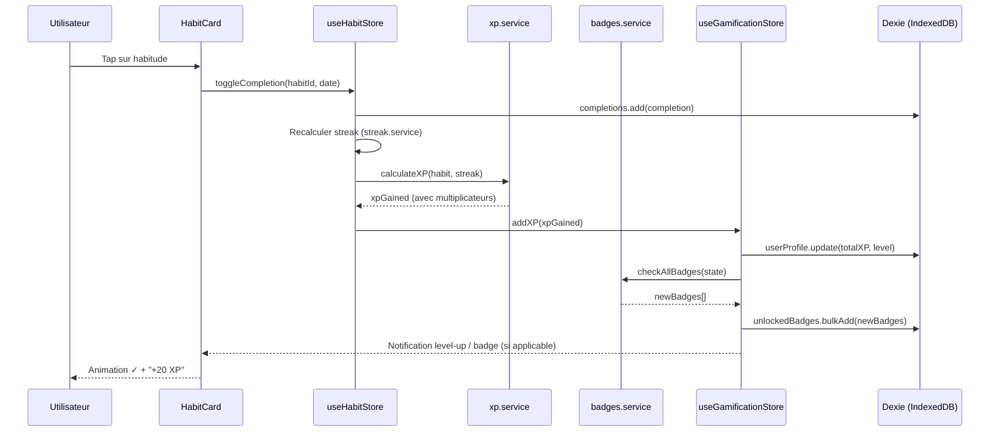
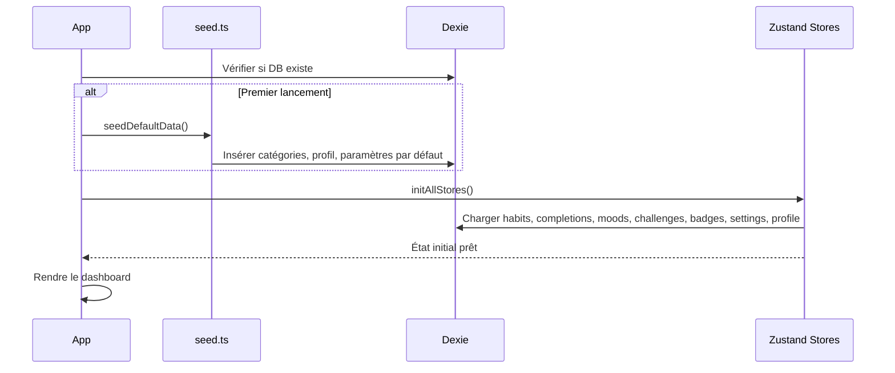
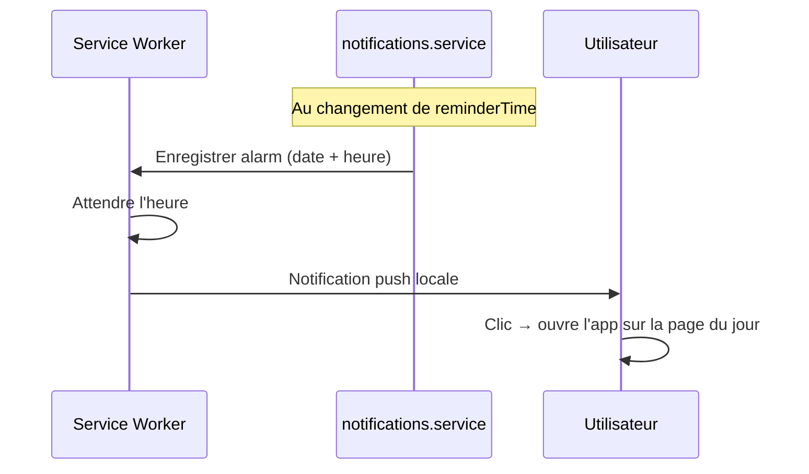

# ARCHITECTURE.md — Architecture technique de Habix

> React + Vite + TypeScript + Tailwind CSS + Recharts + Zustand + Dexie.js
> 100 % locale, PWA installable, offline-first.

---

## 1. Arborescence du projet

```
habix/
├── public/
│   ├── favicon.svg
│   ├── manifest.json               # PWA manifest
│   ├── icons/                       # Icônes PWA (192, 512, maskable)
│   └── sw.js                        # Service Worker (généré par vite-plugin-pwa)
│
├── docs/                            # Documentation (ce dossier)
│   ├── SPEC.md
│   ├── ARCHITECTURE.md
│   ├── STREAK_RULES.md
│   ├── DESIGN.md
│   └── PLAN.md
│
├── src/
│   ├── main.tsx                     # Point d'entrée React
│   ├── App.tsx                      # Router + layout principal
│   ├── index.css                    # Tailwind directives + tokens CSS custom
│   ├── vite-env.d.ts
│   │
│   ├── db/                          # Couche données (Dexie)
│   │   ├── index.ts                 # Instance Dexie, définition du schéma
│   │   ├── migrations.ts            # Hooks de migration de schéma
│   │   └── seed.ts                  # Données initiales (catégories par défaut)
│   │
│   ├── models/                      # Types TypeScript (pas de logique)
│   │   ├── habit.ts
│   │   ├── completion.ts
│   │   ├── category.ts
│   │   ├── mood.ts
│   │   ├── challenge.ts
│   │   ├── badge.ts
│   │   ├── user-profile.ts
│   │   └── settings.ts
│   │
│   ├── stores/                      # Zustand stores
│   │   ├── useHabitStore.ts         # CRUD habitudes + complétion
│   │   ├── useMoodStore.ts          # CRUD humeur
│   │   ├── useChallengeStore.ts     # Gestion des défis
│   │   ├── useGamificationStore.ts  # XP, niveau, badges, titres
│   │   ├── useSettingsStore.ts      # Préférences utilisateur
│   │   └── useUIStore.ts            # État UI (modals, toasts, navigation)
│   │
│   ├── services/                    # Logique métier pure (pas de React)
│   │   ├── streak.ts                # Calcul des streaks (cf. STREAK_RULES.md)
│   │   ├── xp.ts                    # Calcul XP, niveau, multiplicateurs
│   │   ├── badges.ts                # Évaluation des conditions de badges
│   │   ├── challenges.ts            # Logique des défis 21/30j
│   │   ├── review.ts               # Génération de la revue hebdomadaire
│   │   ├── notifications.ts        # Programmation des notifications
│   │   ├── export-import.ts         # Export/import JSON
│   │   └── date-utils.ts           # Utilitaires de dates (fuseaux, minuit…)
│   │
│   ├── hooks/                       # Custom React hooks
│   │   ├── useHabitsForDate.ts      # Habitudes attendues pour une date
│   │   ├── useStreak.ts             # Streak courant/meilleur pour une habitude
│   │   ├── useCompletionRate.ts     # Taux de complétion (jour/semaine/mois)
│   │   ├── useLevel.ts             # Niveau et progression XP
│   │   ├── useBadges.ts            # Badges débloqués/verrouillés
│   │   ├── useNotifications.ts     # Gestion des permissions et rappels
│   │   └── useDarkMode.ts          # Thème clair/sombre
│   │
│   ├── components/                  # Composants React
│   │   ├── layout/
│   │   │   ├── AppShell.tsx         # Layout principal (sidebar/bottomnav)
│   │   │   ├── Sidebar.tsx          # Navigation desktop
│   │   │   ├── BottomNav.tsx        # Navigation mobile
│   │   │   ├── Header.tsx           # Header avec XP bar et profil
│   │   │   └── PageContainer.tsx    # Wrapper de page avec transitions
│   │   │
│   │   ├── habits/
│   │   │   ├── HabitCard.tsx        # Carte d'habitude (dashboard)
│   │   │   ├── HabitList.tsx        # Liste triable par catégorie
│   │   │   ├── HabitForm.tsx        # Formulaire création/édition
│   │   │   ├── HabitDetail.tsx      # Vue détaillée d'une habitude
│   │   │   ├── NumericInput.tsx     # Saisie numérique pour habitudes chiffrées
│   │   │   ├── CompletionToggle.tsx # Bouton de complétion avec animation
│   │   │   └── ProgressRing.tsx     # Cercle de progression (chiffrées)
│   │   │
│   │   ├── calendar/
│   │   │   ├── HeatmapCalendar.tsx  # Calendrier annuel type GitHub
│   │   │   ├── MonthGrid.tsx        # Grille mensuelle
│   │   │   └── DayCell.tsx          # Cellule de jour (couleur selon état)
│   │   │
│   │   ├── stats/
│   │   │   ├── CompletionChart.tsx  # Graphe complétion (Recharts BarChart)
│   │   │   ├── StreakChart.tsx       # Graphe streaks (Recharts LineChart)
│   │   │   ├── MoodChart.tsx        # Courbe d'humeur (Recharts AreaChart)
│   │   │   ├── CategoryBreakdown.tsx # Répartition par catégorie (PieChart)
│   │   │   └── StatCard.tsx         # Carte de statistique (KPI)
│   │   │
│   │   ├── gamification/
│   │   │   ├── XPBar.tsx            # Barre de progression XP
│   │   │   ├── LevelUpModal.tsx     # Modal de level-up avec confettis
│   │   │   ├── BadgeGrid.tsx        # Grille de badges
│   │   │   ├── BadgeCard.tsx        # Carte de badge (débloqué/verrouillé)
│   │   │   ├── TitleSelector.tsx    # Sélecteur de titre
│   │   │   └── XPPopup.tsx          # Popup "+20 XP" animé
│   │   │
│   │   ├── mood/
│   │   │   ├── MoodPicker.tsx       # Sélecteur d'émojis
│   │   │   ├── MoodTagSelector.tsx  # Sélecteur de tags
│   │   │   └── MoodEntryModal.tsx   # Modal de saisie humeur
│   │   │
│   │   ├── challenges/
│   │   │   ├── ChallengeCard.tsx    # Carte de défi
│   │   │   ├── ChallengeProgress.tsx # Barre de progression du défi
│   │   │   └── NewChallengeModal.tsx # Modal de création de défi
│   │   │
│   │   ├── review/
│   │   │   ├── WeeklyReview.tsx     # Dashboard de revue hebdomadaire
│   │   │   └── ReviewHistory.tsx    # Historique des revues
│   │   │
│   │   └── ui/                      # Composants UI génériques
│   │       ├── Button.tsx
│   │       ├── Modal.tsx
│   │       ├── Toast.tsx
│   │       ├── Card.tsx
│   │       ├── Tabs.tsx
│   │       ├── Select.tsx
│   │       ├── Input.tsx
│   │       ├── Toggle.tsx
│   │       ├── Tooltip.tsx
│   │       ├── ConfirmDialog.tsx
│   │       ├── EmptyState.tsx
│   │       └── Confetti.tsx
│   │
│   ├── pages/                       # Pages (composants de route)
│   │   ├── TodayPage.tsx            # Dashboard du jour
│   │   ├── CalendarPage.tsx         # Vue calendrier
│   │   ├── StatsPage.tsx            # Statistiques globales
│   │   ├── ReviewPage.tsx           # Revue hebdomadaire
│   │   ├── ChallengesPage.tsx       # Défis
│   │   ├── ProfilePage.tsx          # Profil et badges
│   │   ├── SettingsPage.tsx         # Paramètres
│   │   └── HabitDetailPage.tsx      # Détail d'une habitude
│   │
│   ├── constants/                   # Constantes
│   │   ├── badges.ts               # Définition des 35 badges
│   │   ├── titles.ts               # Définition des titres
│   │   ├── xp.ts                   # Table XP, multiplicateurs
│   │   ├── defaults.ts             # Valeurs par défaut
│   │   └── mood-tags.ts            # Tags d'humeur prédéfinis
│   │
│   └── utils/                       # Utilitaires purs
│       ├── uuid.ts                  # Génération UUID (crypto.randomUUID)
│       ├── format.ts               # Formatage dates, nombres
│       ├── cn.ts                   # Merge classNames (clsx + twMerge)
│       └── validators.ts           # Validation de schéma pour import
│
├── index.html
├── tailwind.config.ts
├── postcss.config.js
├── tsconfig.json
├── tsconfig.node.json
├── vite.config.ts                   # Config Vite + PWA plugin
├── package.json
└── README.md
```

---

## 2. Modèle de données — Schéma Dexie

### 2.1 Définition de la base

```typescript
// src/db/index.ts
import Dexie, { type Table } from 'dexie';
import type { Habit } from '../models/habit';
import type { Completion } from '../models/completion';
import type { Category } from '../models/category';
import type { MoodEntry } from '../models/mood';
import type { Challenge } from '../models/challenge';
import type { UnlockedBadge } from '../models/badge';
import type { UserProfile } from '../models/user-profile';
import type { FreezeDay } from '../models/freeze-day';

class HabixDB extends Dexie {
  habits!: Table<Habit>;
  completions!: Table<Completion>;
  categories!: Table<Category>;
  moods!: Table<MoodEntry>;
  challenges!: Table<Challenge>;
  unlockedBadges!: Table<UnlockedBadge>;
  userProfile!: Table<UserProfile>;
  freezeDays!: Table<FreezeDay>;

  constructor() {
    super('habix');

    this.version(1).stores({
      habits:         'id, categoryId, frequencyType, isArchived, sortOrder',
      completions:    'id, habitId, date, [habitId+date]',
      categories:     'id, sortOrder',
      moods:          'id, date',
      challenges:     'id, habitId, status, [habitId+status]',
      unlockedBadges: 'id, badgeId, unlockedAt',
      userProfile:    'id',
      freezeDays:     'id, habitId, date, [habitId+date]',
    });
  }
}

export const db = new HabixDB();
```

### 2.2 Types — Habitude

```typescript
// src/models/habit.ts
export type FrequencyType = 'daily' | 'weekly_fixed' | 'weekly_flex' | 'interval';
export type TargetType = 'boolean' | 'numeric';
export type Difficulty = 'easy' | 'medium' | 'hard';

export interface FrequencyConfigDaily {}

export interface FrequencyConfigWeeklyFixed {
  days: number[]; // 0=dim, 1=lun … 6=sam
}

export interface FrequencyConfigWeeklyFlex {
  timesPerWeek: number; // ex: 3
}

export interface FrequencyConfigInterval {
  everyNDays: number; // ex: 3 → tous les 3 jours
}

export type FrequencyConfig =
  | FrequencyConfigDaily
  | FrequencyConfigWeeklyFixed
  | FrequencyConfigWeeklyFlex
  | FrequencyConfigInterval;

export interface Habit {
  id: string;
  name: string;
  description: string;
  icon: string;          // emoji
  color: string;         // hex
  categoryId: string | null;
  frequencyType: FrequencyType;
  frequencyConfig: FrequencyConfig;
  targetType: TargetType;
  targetValue: number | null;   // null si boolean
  targetUnit: string | null;    // null si boolean
  difficulty: Difficulty;
  reminderTime: string | null;  // "HH:mm" ou null
  restDays: number[];           // jours de repos (0-6)
  isArchived: boolean;
  createdAt: Date;
  sortOrder: number;
}
```

### 2.3 Types — Complétion

```typescript
// src/models/completion.ts
export interface Completion {
  id: string;
  habitId: string;
  date: string;          // "YYYY-MM-DD" en date locale
  value: number;         // 1 pour boolean, valeur pour numeric
  isRetroactive: boolean;
  completedAt: Date;     // timestamp réel
}
```

### 2.4 Types — Jour de gel

```typescript
// src/models/freeze-day.ts
export interface FreezeDay {
  id: string;
  habitId: string;       // gel par habitude
  date: string;          // "YYYY-MM-DD"
  createdAt: Date;
}
```

### 2.5 Types — Catégorie

```typescript
// src/models/category.ts
export interface Category {
  id: string;
  name: string;
  icon: string;
  color: string;
  sortOrder: number;
}
```

### 2.6 Types — Humeur

```typescript
// src/models/mood.ts
export interface MoodEntry {
  id: string;
  date: string;          // "YYYY-MM-DD"
  level: 1 | 2 | 3 | 4 | 5;
  tags: string[];
  note: string;
  createdAt: Date;
}
```

### 2.7 Types — Défi

```typescript
// src/models/challenge.ts
export type ChallengeStatus = 'active' | 'completed' | 'failed' | 'abandoned';

export interface Challenge {
  id: string;
  habitId: string;
  duration: 21 | 30;
  startDate: string;     // "YYYY-MM-DD"
  currentDay: number;    // progression (1-based)
  status: ChallengeStatus;
  completedAt: Date | null;
}
```

### 2.8 Types — Badge débloqué

```typescript
// src/models/badge.ts
export interface UnlockedBadge {
  id: string;
  badgeId: string;       // clé dans constants/badges.ts
  unlockedAt: Date;
}

// Définition statique (pas en DB)
export interface BadgeDefinition {
  id: string;
  name: string;
  description: string;
  icon: string;
  category: string;      // ex: "streaks", "completion", etc.
  condition: string;     // description lisible
  // La logique d'évaluation est dans services/badges.ts
}
```

### 2.9 Types — Profil utilisateur

```typescript
// src/models/user-profile.ts
export interface UserProfile {
  id: string;            // toujours "default"
  displayName: string;
  totalXP: number;
  currentLevel: number;
  selectedTitle: string;
  createdAt: Date;
}
```

### 2.10 Types — Paramètres

```typescript
// src/models/settings.ts
export type ThemeMode = 'light' | 'dark' | 'system';
export type WeekDay = 'monday' | 'tuesday' | 'wednesday' | 'thursday' | 'friday' | 'saturday' | 'sunday';

export interface Settings {
  id: string;              // toujours "default"
  theme: ThemeMode;
  retroactiveDays: number; // 1-30
  weekStartDay: WeekDay;
  reviewDay: WeekDay;
  eveningReminderTime: string; // "HH:mm"
  showMoodPopup: boolean;
  timezone: string;        // ex: "Europe/Paris"
  customMoodTags: string[]; // tags personnalisés
}
```

---

## 3. Diagramme ER



---

## 4. Découpage des modules et responsabilités

### 4.1 Couche Données (`db/`)

| Fichier | Responsabilité |
|---|---|
| `index.ts` | Instance singleton Dexie, déclaration du schéma et des index |
| `migrations.ts` | Hooks `upgrade()` pour les futures migrations de schéma |
| `seed.ts` | Insertion des catégories par défaut au premier lancement |

**Principes** :
- Aucune logique métier dans cette couche.
- Accès en lecture/écriture uniquement via les stores Zustand.
- Les index composés (`[habitId+date]`) optimisent les requêtes fréquentes.

### 4.2 Couche Stores (`stores/`)

Chaque store Zustand :
1. Expose un état dérivé (données chargées depuis Dexie).
2. Expose des actions (qui écrivent dans Dexie puis mettent à jour l'état).
3. S'initialise au montage du composant `App` via un hook `useInitStores()`.

```
┌─────────────┐     ┌──────────────┐     ┌─────────────┐
│  Component   │────▶│  Zustand     │────▶│  Dexie      │
│  (React)     │◀────│  Store       │◀────│  (IndexedDB) │
└─────────────┘     └──────────────┘     └─────────────┘
      │                    │
      │                    ▼
      │             ┌──────────────┐
      └────────────▶│  Services    │
                    │  (logique    │
                    │   métier)    │
                    └──────────────┘
```

| Store | État | Actions principales |
|---|---|---|
| `useHabitStore` | habits, completions, freezeDays | createHabit, updateHabit, archiveHabit, toggleCompletion, setNumericValue, freezeDay |
| `useMoodStore` | moods | saveMood, getMoodForDate |
| `useChallengeStore` | challenges | startChallenge, abandonChallenge, updateChallengeProgress |
| `useGamificationStore` | xp, level, unlockedBadges | addXP, checkBadges, selectTitle |
| `useSettingsStore` | settings | updateSetting |
| `useUIStore` | modals, toasts, activeTab | openModal, closeModal, showToast |

### 4.3 Couche Services (`services/`)

Fonctions pures, testables unitairement, sans dépendance React.

| Service | Responsabilité |
|---|---|
| `streak.ts` | Calcul streak courant et meilleur (cf. STREAK_RULES.md) |
| `xp.ts` | Calcul XP gagné par complétion, multiplicateurs, niveau |
| `badges.ts` | Évaluation des conditions de déblocage des badges |
| `challenges.ts` | Logique de progression et statut des défis |
| `review.ts` | Agrégation des données pour la revue hebdomadaire |
| `notifications.ts` | Planification des notifications via Service Worker |
| `export-import.ts` | Sérialisation/désérialisation et validation JSON |
| `date-utils.ts` | Gestion des dates locales, fuseaux, calcul de minuit |

### 4.4 Couche Hooks (`hooks/`)

Hooks React qui combinent stores et services pour fournir des données dérivées
prêtes à consommer par les composants.

```typescript
// Exemple : useHabitsForDate.ts
function useHabitsForDate(date: string) {
  const habits = useHabitStore(s => s.habits);
  const completions = useHabitStore(s => s.completions);
  // Filtre les habitudes attendues pour cette date
  // en tenant compte de frequencyType, restDays, etc.
  return useMemo(() => filterHabitsForDate(habits, completions, date), [habits, completions, date]);
}
```

### 4.5 Couche Composants (`components/`)

- **`layout/`** : structure de l'application (shell, navigation, header).
- **`habits/`** : composants métier liés aux habitudes.
- **`calendar/`** : composants de calendrier heatmap.
- **`stats/`** : graphiques Recharts encapsulés.
- **`gamification/`** : XP bar, badges, level-up.
- **`mood/`** : saisie et visualisation de l'humeur.
- **`challenges/`** : gestion des défis.
- **`review/`** : revue hebdomadaire.
- **`ui/`** : composants génériques réutilisables (design system).

### 4.6 Couche Pages (`pages/`)

Composants de route qui assemblent les composants métier.
Chaque page est lazy-loadée via `React.lazy()` pour le code splitting.

---

## 5. Flux de données

### 5.1 Complétion d'une habitude (flux principal)



### 5.2 Chargement initial (bootstrap)



### 5.3 Notification / Rappel



### 5.4 Export / Import

```
Export :
  SettingsPage → export-import.service.exportAll()
    → db.habits.toArray() + db.completions.toArray() + ...
    → JSON.stringify({ version, exportDate, data })
    → Blob → download

Import :
  SettingsPage → FileInput → export-import.service.importJSON(file)
    → JSON.parse()
    → validators.validateSchema(data)
    → Mode remplacement : db.delete() + db.open() + bulkAdd
    → Mode fusion : upsert intelligent par clé primaire/composite
    → Recalculer XP/badges/streaks
```

---

## 6. Routing

```typescript
// React Router v6+
const routes = [
  { path: '/',             element: <TodayPage /> },
  { path: '/calendar',     element: <CalendarPage /> },
  { path: '/stats',        element: <StatsPage /> },
  { path: '/review',       element: <ReviewPage /> },
  { path: '/challenges',   element: <ChallengesPage /> },
  { path: '/profile',      element: <ProfilePage /> },
  { path: '/settings',     element: <SettingsPage /> },
  { path: '/habit/:id',    element: <HabitDetailPage /> },
];
```

Stratégie : **hash router** (`createHashRouter`) pour compatibilité PWA sans
configuration serveur.

---

## 7. Configuration PWA

### 7.1 Plugin Vite

```typescript
// vite.config.ts (extrait)
import { VitePWA } from 'vite-plugin-pwa';

export default defineConfig({
  plugins: [
    react(),
    VitePWA({
      registerType: 'autoUpdate',
      includeAssets: ['favicon.svg'],
      manifest: {
        name: 'Habix — Suivi d\'habitudes',
        short_name: 'Habix',
        description: 'Tracker d\'habitudes moderne et gamifié',
        theme_color: '#6366f1',
        background_color: '#0f172a',
        display: 'standalone',
        start_url: '/',
        icons: [
          { src: '/icons/icon-192.png', sizes: '192x192', type: 'image/png' },
          { src: '/icons/icon-512.png', sizes: '512x512', type: 'image/png' },
          { src: '/icons/icon-512-maskable.png', sizes: '512x512', type: 'image/png', purpose: 'maskable' },
        ],
      },
      workbox: {
        globPatterns: ['**/*.{js,css,html,svg,png,woff2}'],
      },
    }),
  ],
});
```

### 7.2 Notifications locales

Les notifications sont programmées via l'API `Notification` du navigateur,
orchestrées depuis le Service Worker. Pas de push server — tout est local.

```
1. L'utilisateur active un rappel sur une habitude (HH:mm)
2. notifications.service calcule le prochain timestamp
3. setTimeout / setInterval dans le SW pour déclencher la notification
4. Fallback : vérification au lancement de l'app des rappels manqués
```

---

## 8. Dépendances

| Package | Version | Usage |
|---|---|---|
| `react` | ^18 | UI |
| `react-dom` | ^18 | Rendu DOM |
| `react-router-dom` | ^6 | Routing |
| `zustand` | ^4 | State management |
| `dexie` | ^4 | IndexedDB wrapper |
| `dexie-react-hooks` | ^1 | Hooks live query |
| `recharts` | ^2 | Graphiques |
| `tailwindcss` | ^3 | Styles |
| `clsx` | ^2 | Merge classnames |
| `tailwind-merge` | ^2 | Résolution conflits Tailwind |
| `vite-plugin-pwa` | ^0.17 | PWA + Service Worker |
| `date-fns` | ^3 | Manipulation de dates |
| `uuid` | ^9 | Génération UUID (fallback si crypto.randomUUID indisponible) |

Dev dependencies : `typescript`, `@types/react`, `vite`, `postcss`, `autoprefixer`,
`eslint`, `prettier`.

---

## 9. Conventions de code

| Aspect | Convention |
|---|---|
| **Nommage fichiers** | `kebab-case` pour les fichiers, `PascalCase` pour les composants |
| **Nommage variables** | `camelCase` |
| **Types** | Interfaces pour les modèles, types pour les unions |
| **Exports** | Named exports uniquement (pas de `export default`) |
| **Composants** | Functional components + hooks uniquement |
| **État** | Zustand pour l'état global, `useState` pour l'état local |
| **Styles** | Classes Tailwind, `cn()` helper pour les conditionnels |
| **Dates** | Toujours en `YYYY-MM-DD` pour le stockage, `date-fns` pour la manipulation |
| **Tests** | Vitest pour les services, React Testing Library pour les composants |
