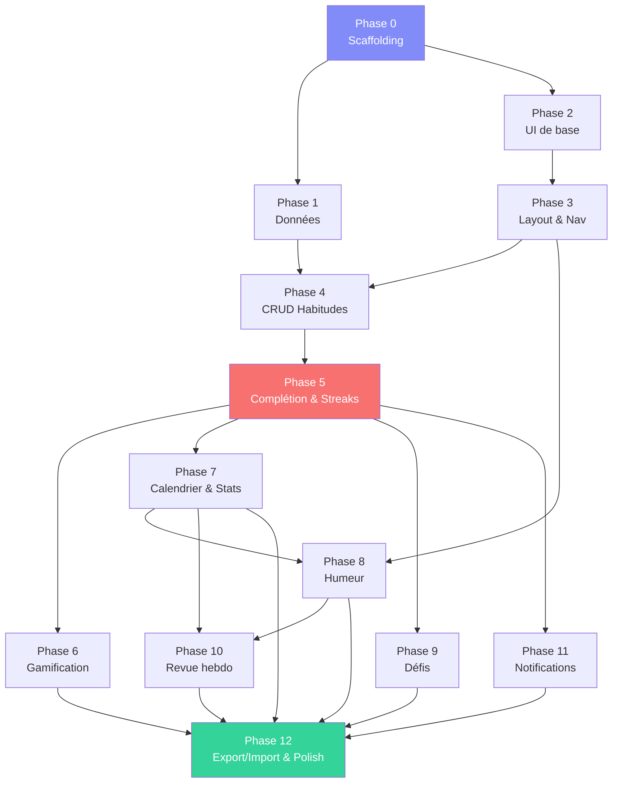

# PLAN.md — Étapes d'implémentation de Habix

> Plan séquentiel en 12 phases. Chaque phase produit un livrable testable.
> Durée estimée : ~4-5 jours de développement intensif.

---

## Phase 0 — Scaffolding et infrastructure (2-3h)

### Objectif
Projet Vite + React + TS + Tailwind fonctionnel, PWA installable, structure de
dossiers en place.

### Tâches

- [ ] **0.1** Initialiser le projet Vite React-TS :
  `npx -y create-vite@latest ./ --template react-ts`
- [ ] **0.2** Installer les dépendances :
  ```
  npm install zustand dexie dexie-react-hooks recharts react-router-dom
              date-fns clsx tailwind-merge lucide-react
  npm install -D tailwindcss postcss autoprefixer vite-plugin-pwa
  ```
- [ ] **0.3** Configurer Tailwind (`tailwind.config.ts`, `postcss.config.js`,
  directives dans `index.css`).
- [ ] **0.4** Configurer le plugin PWA dans `vite.config.ts` (manifest, service
  worker, icônes).
- [ ] **0.5** Créer l'arborescence de dossiers vide (cf. ARCHITECTURE.md).
- [ ] **0.6** Configurer les variables CSS du design system (palette, typo,
  espacement) dans `index.css`.
- [ ] **0.7** Importer la police Inter (Google Fonts).
- [ ] **0.8** Créer le helper `cn()` (`clsx` + `tailwind-merge`).
- [ ] **0.9** Créer les icônes PWA (192, 512, maskable) et le favicon SVG.
- [ ] **0.10** Vérifier : `npm run dev` lance l'app, PWA installable en local.

### Livrable
App vide installable en PWA avec le bon thème sombre.

---

## Phase 1 — Couche données (2-3h)

### Objectif
Base IndexedDB opérationnelle avec schéma complet, seed et types.

### Tâches

- [ ] **1.1** Créer tous les types TypeScript dans `models/` :
  `habit.ts`, `completion.ts`, `category.ts`, `mood.ts`, `challenge.ts`,
  `badge.ts`, `user-profile.ts`, `settings.ts`, `freeze-day.ts`.
- [ ] **1.2** Implémenter `db/index.ts` : instance Dexie avec tous les stores et
  index (cf. ARCHITECTURE.md §2.1).
- [ ] **1.3** Implémenter `db/seed.ts` : catégories par défaut, profil initial,
  paramètres par défaut.
- [ ] **1.4** Implémenter `db/migrations.ts` : structure pour les futures migrations.
- [ ] **1.5** Créer `constants/badges.ts` : 35 définitions de badges.
- [ ] **1.6** Créer `constants/titles.ts` : définitions des titres.
- [ ] **1.7** Créer `constants/xp.ts` : table XP, multiplicateurs.
- [ ] **1.8** Créer `constants/mood-tags.ts` : tags d'humeur prédéfinis.
- [ ] **1.9** Créer `constants/defaults.ts` : valeurs par défaut des paramètres.
- [ ] **1.10** Vérifier : ouvrir DevTools → Application → IndexedDB → la base
  `habix` existe avec les tables peuplées.

### Livrable
Base de données fonctionnelle, vérifiable dans DevTools.

---

## Phase 2 — Composants UI de base (3-4h)

### Objectif
Design system : composants réutilisables sans logique métier.

### Tâches

- [ ] **2.1** `Button.tsx` : variantes primary, secondary, ghost, danger, icon.
- [ ] **2.2** `Card.tsx` : variantes default, elevated, interactive, glow.
- [ ] **2.3** `Modal.tsx` : overlay blur, animation open/close, fermeture Esc/clic.
- [ ] **2.4** `Toast.tsx` : variantes, auto-dismiss, barre de progression.
- [ ] **2.5** `Input.tsx` : text, number, avec label et erreur.
- [ ] **2.6** `Select.tsx` : select personnalisé (dropdown).
- [ ] **2.7** `Toggle.tsx` : switch on/off avec animation spring.
- [ ] **2.8** `Tabs.tsx` : onglets avec indicateur animé.
- [ ] **2.9** `Tooltip.tsx` : tooltip au hover/focus.
- [ ] **2.10** `ConfirmDialog.tsx` : modal de confirmation (suppression, etc.).
- [ ] **2.11** `EmptyState.tsx` : illustration + message quand une liste est vide.
- [ ] **2.12** `Confetti.tsx` : composant canvas pour les confettis.
- [ ] **2.13** Créer une page `/storybook` temporaire pour visualiser tous les
  composants.

### Livrable
Design system complet et visitable sur une page de démo.

---

## Phase 3 — Layout et navigation (2-3h)

### Objectif
Shell de l'application avec navigation fonctionnelle.

### Tâches

- [ ] **3.1** `AppShell.tsx` : layout principal responsive (sidebar/bottomnav +
  contenu).
- [ ] **3.2** `Sidebar.tsx` : navigation desktop avec profil mini + XP bar.
- [ ] **3.3** `BottomNav.tsx` : navigation mobile avec glass effect.
- [ ] **3.4** `Header.tsx` : header responsive avec XP bar et titre de page.
- [ ] **3.5** `PageContainer.tsx` : wrapper avec transition de page (fade+slide).
- [ ] **3.6** Configurer React Router (hash router) dans `App.tsx` avec toutes les
  routes et lazy loading.
- [ ] **3.7** Implémenter `useSettingsStore.ts` : chargement des paramètres depuis
  Dexie, actions de mise à jour.
- [ ] **3.8** Implémenter `useUIStore.ts` : gestion modals, toasts, active tab.
- [ ] **3.9** Implémenter `useDarkMode.ts` : gestion du thème (dark/light/system).
- [ ] **3.10** Pages placeholder pour chaque route (titre + EmptyState).
- [ ] **3.11** Vérifier : navigation fluide entre toutes les pages, responsive,
  thème clair/sombre fonctionnel.

### Livrable
Application navigable avec toutes les routes, responsive, thème fonctionnel.

---

## Phase 4 — CRUD Habitudes (3-4h)

### Objectif
Créer, lire, modifier, archiver des habitudes.

### Tâches

- [ ] **4.1** Implémenter `useHabitStore.ts` :
  - État : habits, loading.
  - Actions : loadHabits, createHabit, updateHabit, archiveHabit, deleteHabit,
    reorderHabits.
- [ ] **4.2** `HabitForm.tsx` : formulaire complet de création/édition :
  - Nom, description, icône (sélecteur émoji), couleur (palette).
  - Type de fréquence (radio) + config selon le type.
  - Type de cible (boolean/numeric) + objectif + unité.
  - Difficulté (easy/medium/hard).
  - Catégorie (select).
  - Heure de rappel (time picker).
  - Jours de repos (checkboxes).
- [ ] **4.3** `HabitCard.tsx` : carte d'habitude sur le dashboard (sans complétion
  pour l'instant — juste l'affichage).
- [ ] **4.4** `HabitList.tsx` : liste triable par catégorie avec drag & drop
  (optionnel : tri par boutons haut/bas si le DnD est complexe).
- [ ] **4.5** Page « Aujourd'hui » (`TodayPage.tsx`) : afficher les habitudes
  attendues pour la date du jour.
- [ ] **4.6** Hook `useHabitsForDate.ts` : filtrer les habitudes attendues pour une
  date selon leur fréquence et jours de repos.
- [ ] **4.7** Gestion des catégories dans les paramètres (CRUD basique).
- [ ] **4.8** Vérifier : créer 5+ habitudes de types variés, les voir sur le
  dashboard, les modifier, les archiver.

### Livrable
Dashboard avec liste d'habitudes créées par l'utilisateur.

---

## Phase 5 — Complétion et streaks (4-5h)

### Objectif
Cœur fonctionnel : valider des habitudes et voir les streaks.

### Tâches

- [ ] **5.1** Ajouter au store : completions, freezeDays.
  Actions : toggleCompletion, setNumericValue, freezeDay, unfreezeDay.
- [ ] **5.2** `CompletionToggle.tsx` : bouton de complétion binaire avec animation
  de check (checkmark SVG animé).
- [ ] **5.3** `NumericInput.tsx` : saisie numérique (tap court = +1, tap long =
  champ libre).
- [ ] **5.4** `ProgressRing.tsx` : cercle de progression SVG pour les habitudes
  chiffrées.
- [ ] **5.5** Implémenter `services/streak.ts` : toutes les fonctions de calcul
  (cf. STREAK_RULES.md) :
  - `calculateCurrentStreak()`
  - `calculateBestStreak()`
  - `calculateWeeklyFlexStreak()`
  - `calculateIntervalStreak()`
- [ ] **5.6** Hook `useStreak.ts` : streak courant et meilleur pour une habitude.
- [ ] **5.7** Afficher le streak 🔥 sur la HabitCard avec animation pulse.
- [ ] **5.8** Implémenter la saisie rétroactive : sélecteur de date (dans la
  fenêtre configurable) + validation.
- [ ] **5.9** Implémenter le gel : bouton ❄️ sur la carte, logique dans le store.
- [ ] **5.10** Implémenter `services/date-utils.ts` : getLocalDate, subtractDay,
  getDayOfWeek, isDateInRange, getWeekRange.
- [ ] **5.11** Vérifier : compléter des habitudes, voir le streak monter, geler un
  jour, compléter rétroactivement, vérifier que le streak est correct dans tous
  les cas du STREAK_RULES.md.

### Livrable
Complétion fonctionnelle avec streaks calculés correctement.

---

## Phase 6 — Gamification (3-4h)

### Objectif
Système XP, niveaux, badges et titres opérationnel.

### Tâches

- [ ] **6.1** Implémenter `services/xp.ts` :
  - `calculateXPForCompletion()` : XP de base × multiplicateurs.
  - `calculateLevel()` : formule `100 × N^1.5`.
  - `getMultipliers()` : streak, lève-tôt, journée parfaite.
- [ ] **6.2** Implémenter `useGamificationStore.ts` :
  - État : totalXP, currentLevel, unlockedBadges.
  - Actions : addXP, removeXP, checkBadges, selectTitle.
- [ ] **6.3** Implémenter `services/badges.ts` :
  - `evaluateAllBadges()` : vérifie les 35 conditions.
  - Chaque badge a une fonction d'évaluation.
- [ ] **6.4** Intégrer le gain d'XP dans le flux de complétion (useHabitStore →
  useGamificationStore).
- [ ] **6.5** `XPBar.tsx` : barre de progression dans le header/sidebar.
- [ ] **6.6** `XPPopup.tsx` : popup "+20 XP ×1.5" animé après complétion.
- [ ] **6.7** `LevelUpModal.tsx` : modal avec confettis et nouveau titre.
- [ ] **6.8** `BadgeGrid.tsx` + `BadgeCard.tsx` : grille de badges sur la page
  profil.
- [ ] **6.9** Notification toast à chaque badge débloqué.
- [ ] **6.10** `TitleSelector.tsx` : sélecteur de titre dans le profil.
- [ ] **6.11** Hook `useLevel.ts` et `useBadges.ts`.
- [ ] **6.12** Vérifier : compléter des habitudes → XP monte → level up →
  badges se débloquent → titre changeable.

### Livrable
Gamification complète et visible dans toute l'app.

---

## Phase 7 — Calendrier et statistiques (3-4h)

### Objectif
Visualisation des données : heatmap et graphiques Recharts.

### Tâches

- [ ] **7.1** `HeatmapCalendar.tsx` : grille annuelle type GitHub contributions.
  - Couleurs selon l'état (complété/gelé/repos/manqué).
  - 4 niveaux de vert pour les habitudes chiffrées.
  - Animation staggered d'apparition.
- [ ] **7.2** `MonthGrid.tsx` : grille mensuelle (vue détaillée).
- [ ] **7.3** `DayCell.tsx` : cellule de jour avec tooltip au hover.
- [ ] **7.4** `CalendarPage.tsx` : sélecteur d'habitude + heatmap + légende.
- [ ] **7.5** `CompletionChart.tsx` : bar chart du taux de complétion par
  jour/semaine/mois (Recharts BarChart).
- [ ] **7.6** `StreakChart.tsx` : line chart de l'évolution des streaks (Recharts
  LineChart).
- [ ] **7.7** `CategoryBreakdown.tsx` : pie chart de répartition par catégorie
  (Recharts PieChart).
- [ ] **7.8** `StatCard.tsx` : carte KPI (nombre + label + tendance).
- [ ] **7.9** `StatsPage.tsx` : assemblage des graphiques avec tabs
  (7j/30j/90j/1an).
- [ ] **7.10** Hook `useCompletionRate.ts` : calcul du taux de complétion pour
  une période.
- [ ] **7.11** `HabitDetailPage.tsx` : stats détaillées d'une habitude individuelle
  (streak, calendrier, graphe, historique).
- [ ] **7.12** Vérifier : naviguer dans le calendrier, changer de période dans les
  stats, tooltip informatives.

### Livrable
Visualisation complète des données avec graphiques interactifs.

---

## Phase 8 — Humeur (2-3h)

### Objectif
Suivi d'humeur quotidien avec visualisation.

### Tâches

- [ ] **8.1** Implémenter `useMoodStore.ts` :
  - Actions : saveMood, updateMood, getMoodForDate, getMoodsInRange.
- [ ] **8.2** `MoodPicker.tsx` : 5 émojis cliquables avec animation de sélection.
- [ ] **8.3** `MoodTagSelector.tsx` : grille de tags (prédéfinis + personnalisés),
  multi-sélection avec animation toggle.
- [ ] **8.4** `MoodEntryModal.tsx` : modal complète (picker + tags + note +
  sauvegarder).
- [ ] **8.5** Afficher le popup humeur au premier lancement de la journée (si
  activé dans les paramètres).
- [ ] **8.6** `MoodChart.tsx` : courbe d'humeur lissée (Recharts AreaChart).
- [ ] **8.7** Corrélation humeur ↔ complétion (overlay sur le graphe d'humeur).
- [ ] **8.8** Nuage de tags (fréquence) dans les statistiques.
- [ ] **8.9** Intégrer la section humeur dans StatsPage.
- [ ] **8.10** Vérifier : saisir l'humeur, voir la courbe, corrélation visible.

### Livrable
Suivi d'humeur fonctionnel avec visualisation.

---

## Phase 9 — Défis (2-3h)

### Objectif
Système de défis 21/30 jours.

### Tâches

- [ ] **9.1** Implémenter `useChallengeStore.ts` :
  - Actions : startChallenge, abandonChallenge, checkChallengeProgress (appelé à
    chaque complétion).
- [ ] **9.2** Implémenter `services/challenges.ts` :
  - `updateChallengeProgress()` : logique de progression (gel = suspendu, manqué =
    échoué).
  - `getChallengeStatus()`.
- [ ] **9.3** `NewChallengeModal.tsx` : sélection d'habitude + durée (21/30j).
- [ ] **9.4** `ChallengeCard.tsx` : carte de défi (progression, jours restants,
  statut).
- [ ] **9.5** `ChallengeProgress.tsx` : barre de progression avec jours
  individuels (✅ ❄️ ⏳).
- [ ] **9.6** `ChallengesPage.tsx` : défis actifs + historique (terminés/échoués).
- [ ] **9.7** Intégrer la vérification des défis dans le flux de complétion.
- [ ] **9.8** Badge « Défi relevé » / « Défi ultime » à la complétion.
- [ ] **9.9** Vérifier : lancer un défi, progresser, geler, échouer, terminer.

### Livrable
Système de défis complet.

---

## Phase 10 — Revue hebdomadaire (2-3h)

### Objectif
Dashboard de revue automatique.

### Tâches

- [ ] **10.1** Implémenter `services/review.ts` :
  - `generateWeeklyReview()` : agrège toutes les données de la semaine.
  - Score global, top/flop habitudes, streaks, XP, humeur, badges, défis.
- [ ] **10.2** `WeeklyReview.tsx` : dashboard complet avec :
  - Score global (gros chiffre + comparaison S-1).
  - Top 3 / Bottom 3 habitudes.
  - Évolution des streaks (mini graphe).
  - XP gagnés + progression de niveau.
  - Courbe d'humeur.
  - Badges débloqués.
  - Progression des défis.
- [ ] **10.3** `ReviewHistory.tsx` : liste des revues passées (une par semaine).
- [ ] **10.4** `ReviewPage.tsx` : page complète avec sélecteur de semaine.
- [ ] **10.5** Notification in-app le jour de la revue (bannière « Ta revue
  hebdomadaire est prête ! »).
- [ ] **10.6** Vérifier : consulter la revue de la semaine courante et des
  semaines passées.

### Livrable
Revue hebdomadaire automatique.

---

## Phase 11 — Notifications et rappels (2-3h)

### Objectif
Rappels in-app et notifications navigateur.

### Tâches

- [ ] **11.1** Implémenter `services/notifications.ts` :
  - `requestPermission()` : demander l'autorisation de notification.
  - `scheduleNotification()` : programmer une notification locale.
  - `cancelNotification()`.
- [ ] **11.2** Implémenter `useNotifications.ts` : hook pour gérer l'état des
  permissions et programmer les rappels.
- [ ] **11.3** Programmer les rappels par habitude via le Service Worker.
- [ ] **11.4** Bannière in-app « Il te reste X habitudes aujourd'hui ! » (au
  lancement + rappel de soirée).
- [ ] **11.5** Badge numérique sur l'onglet « Aujourd'hui » (nombre d'habitudes
  restantes).
- [ ] **11.6** Clic sur la notification → ouvrir l'app sur la page du jour.
- [ ] **11.7** Paramètres de notification dans SettingsPage.
- [ ] **11.8** Vérifier : activer un rappel, recevoir la notification, rappels
  in-app visibles.

### Livrable
Système de notifications complet.

---

## Phase 12 — Export/Import, paramètres, polish (3-4h)

### Objectif
Fonctionnalités secondaires, page paramètres complète, finitions.

### Tâches

- [ ] **12.1** Implémenter `services/export-import.ts` :
  - `exportAll()` : sérialiser toute la DB en JSON.
  - `importJSON()` : valider + importer (modes remplacement / fusion).
  - `validateSchema()` : validation du schéma JSON importé.
- [ ] **12.2** `SettingsPage.tsx` complète :
  - Thème (clair/sombre/système).
  - Nom d'utilisateur.
  - Fenêtre de rétroactivité (slider 1-30).
  - Premier jour de la semaine.
  - Jour de la revue hebdomadaire.
  - Heure du rappel de soirée.
  - Popup humeur au lancement.
  - Fuseau horaire.
  - Tags d'humeur personnalisés.
  - Gestion des catégories.
  - Export / Import.
  - Bouton « Installer l'application » (PWA).
  - Info version et crédits.
- [ ] **12.3** `ProfilePage.tsx` complète :
  - Nom + titre.
  - Niveau + XP bar.
  - Stats globales (KPI).
  - Galerie de badges.
  - Sélecteur de titre.
- [ ] **12.4** **Polish visuel** :
  - Vérifier toutes les animations.
  - Vérifier le responsive sur mobile (320px → 1440px).
  - Vérifier le mode clair.
  - Vérifier les états vides (EmptyState).
  - Vérifier les contrastes WCAG.
  - Ajouter les transitions de page.
- [ ] **12.5** **Performance** :
  - Vérifier le lazy loading des pages.
  - Optimiser les re-renders (React.memo, useMemo).
  - Vérifier la taille du bundle (`npm run build` + analyse).
  - Tester avec Lighthouse (Performance, PWA, Accessibility).
- [ ] **12.6** **Tests** :
  - Tests unitaires pour `services/streak.ts` (tous les cas de STREAK_RULES.md).
  - Tests unitaires pour `services/xp.ts`.
  - Tests unitaires pour `services/badges.ts`.
  - Tests d'intégration basiques (créer habitude → compléter → vérifier XP).
- [ ] **12.7** `README.md` : description du projet, instructions d'installation,
  stack technique, captures d'écran.
- [ ] **12.8** Vérifier : export fonctionnel, import (remplacement + fusion),
  paramètres persistés, profil complet.

### Livrable
Application complète, testée, prête à l'utilisation.

---

## Récapitulatif

| Phase | Nom | Durée estimée | Dépendances |
|---|---|---|---|
| 0 | Scaffolding | 2-3h | — |
| 1 | Couche données | 2-3h | Phase 0 |
| 2 | Composants UI | 3-4h | Phase 0 |
| 3 | Layout et navigation | 2-3h | Phase 2 |
| 4 | CRUD Habitudes | 3-4h | Phases 1, 3 |
| 5 | Complétion et streaks | 4-5h | Phase 4 |
| 6 | Gamification | 3-4h | Phase 5 |
| 7 | Calendrier et stats | 3-4h | Phase 5 |
| 8 | Humeur | 2-3h | Phases 3, 7 |
| 9 | Défis | 2-3h | Phase 5 |
| 10 | Revue hebdomadaire | 2-3h | Phases 7, 8 |
| 11 | Notifications | 2-3h | Phase 5 |
| 12 | Export/Import + polish | 3-4h | Toutes |

**Total estimé : 32-43h** (~4-5 jours intensifs)

### Graphe de dépendances



> 🔴 La **phase 5** (Complétion & Streaks) est le chemin critique — c'est le cœur
> fonctionnel de l'app. Tout le reste en dépend.

---

## Notes pour l'implémentation

1. **Phases 1 et 2 sont parallélisables** (données ≠ UI).
2. **Phases 7, 8, 9, 11 sont partiellement parallélisables** après la phase 5.
3. **La phase 12 est le « grand ménage »** — ne pas la sous-estimer.
4. **Tester le streak engine exhaustivement** (phase 5) avant de passer à la
   gamification — les bugs de streak sont les plus dommageables pour l'UX.
5. **Itérer sur le design** au fil des phases, pas seulement en phase 12.
